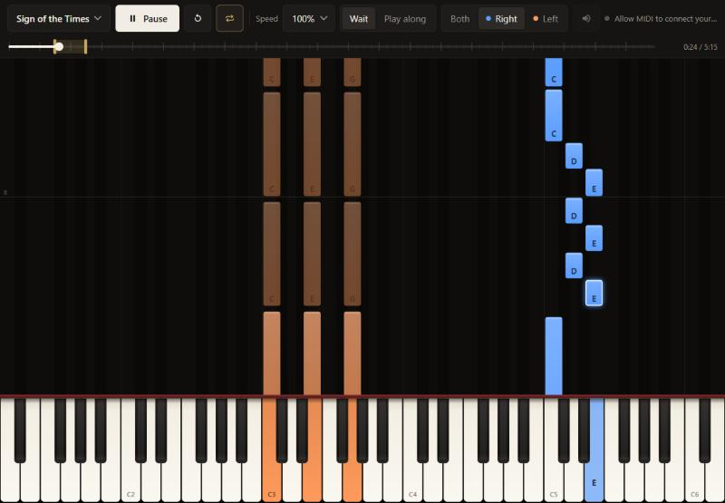

# open-piano

open-piano is a piano trainer that you run on your own network. It shows the notes of a MIDI file as notes that fall onto a keyboard. You play the notes on your digital piano. In Wait mode, the song stops until you play the correct keys.



## How it works

```
PC: app/server.py ──Wi-Fi──> tablet or phone: browser with Web MIDI <──USB MIDI── digital piano
    songs/*.mid
```

- The server runs on a PC. It reads the MIDI files in `songs/` and sends the app to the browser.
- The piano connects to the tablet or phone. The browser reads the keys through Web MIDI.
- The browser can also send the notes of the other hand to the piano. Then the piano plays that hand.

## Requirements

- A PC with Python 3.9 or later.
- A digital piano with USB MIDI.
- A tablet or phone with a browser that has Web MIDI:
  - iPad: the **Web MIDI Browser** app. Safari does not have Web MIDI.
  - Android: Chrome.

## Install and start

1. Download or clone this repository.
2. On Windows, double-click `start.bat`. On other systems, run these commands:
   ```sh
   pip install mido python-rtmidi
   cd app
   python server.py
   ```
3. Find the address in the output, for example `http://192.168.1.20:8000`.
4. On the tablet, open this address in the browser.

Make sure that the PC and the tablet are on the same network. If the tablet cannot open the page, let the firewall of the PC accept connections on TCP port 8000 from the local network.

## Connect the piano

1. Connect the piano to the tablet with a USB cable.
2. If the browser asks for MIDI access, allow it.
3. Make sure that the name of the piano shows at the top right of the page.

On Android, Chrome gives MIDI access only to secure pages. Do these steps one time:

1. Open `chrome://flags/#unsafely-treat-insecure-origin-as-secure`.
2. Enter the address of the server and set the flag to **Enabled**.
3. On Android 17 and later, give Chrome the **Local network** permission.

## Add songs

Put `.mid` files in the `songs/` folder. The song list shows the new files immediately. Use the file name `Artist - Title.mid` to show the artist next to the title.

## Use the trainer

| Control | Function |
|---|---|
| **Wait** | The song stops at the next notes until you play them in the correct sequence. |
| **Play along** | The song does not stop. At the end, the trainer shows your score. |
| **Both / Right / Left** | Selects the hand that you practise. The other hand shows dimmed notes. |
| Speaker button | The piano plays the other hand. |
| **Speed** | Changes the speed from 25% to 150%. |
| Loop button | Repeats 4 bars. To change the loop, move its ends on the timeline. |
| Timeline | Tap or drag to go to a different position in the song. |
| Notes | Drag or flick the notes to move through the song. Tap the notes to start or stop. |

Keyboard of the PC: Space starts and stops, ← and → go one bar back or forward, ↑ and ↓ change the speed, Home goes to the start, L sets the loop.

## Tests

```sh
cd app
node --test tests/*.test.js           # practice logic, song model, timing
python -m unittest test_midi_file     # MIDI file reader
```

## Project structure

| Path | Contents |
|---|---|
| `app/server.py` | HTTP server: the app, the song list, the songs |
| `app/midi_file.py` | Reads a MIDI file: notes, tempo changes, bars |
| `app/pc_midi.py` | Optional: reads a piano that connects to the PC |
| `app/web/js/core/` | Practice logic, song model, time control. No browser code |
| `app/web/js/io/` | Web MIDI, server connection |
| `app/web/js/ui/` | Drawing, timeline, touch input, controls |
| `app/web/js/config.js` | Timing windows, speeds, colours |

## License

MIT. See [LICENSE](LICENSE).
